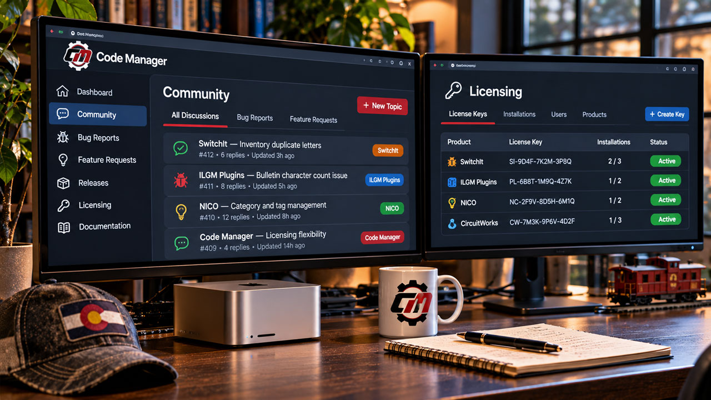
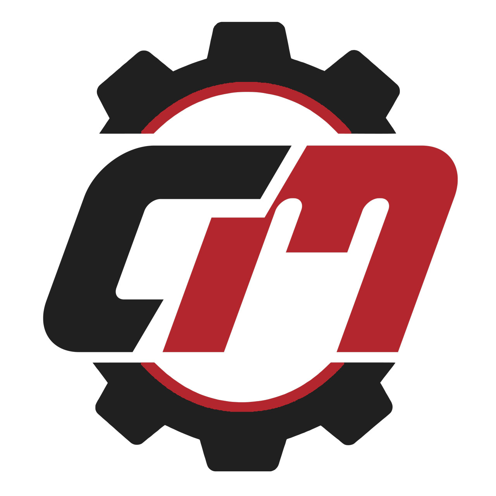

  

<h1 align="center">When Technology Doesn't Fit, We Build What Does.</h1>

**Chris Sgaraglino, Developer** | More than 30 years of technology and business experience

ILGM helps businesses solve problems through custom software, practical technology consulting, systems integration, and managed hosting. We begin with the business outcome, work backward to the requirements, and build or adapt the technology needed to get there. Our work extends well beyond websites: when existing software cannot support a client's goals, we can develop the missing capability.

This is a public overview of the projects and development work behind ILGM. The source repositories and client systems remain private.

### ILGM Plugins

   
  

ILGM Plugins is the software foundation behind many of the websites ILGM builds and hosts. Its portfolio of **more than 70 WordPress and WooCommerce applications** includes original tools and carefully maintained third-party components. These applications handle practical business needs such as publishing announcements, managing commerce, affiliate programs, tracking links, measuring results, and communicating with customers.

For example, ILGM Bulletins lets a client publish a scheduled announcement without rebuilding a page, while other plugins extend the behavior of an online store or provide information that standard WordPress installations do not expose. Some tools are small, focused improvements; others connect several business processes. The common goal is to give clients useful control over their websites without forcing them to become software administrators. Plugins are tested and maintained for ILGM-managed environments, and client systems remain private.

<small>**Technology:** PHP, WordPress APIs, WooCommerce, JavaScript, HTML, CSS, MySQL-compatible WordPress databases, Git, and GitHub. Includes original plugins and maintained third-party forks.</small>

 

---

 

### NICO Intelligence

   
  

NICO Intelligence, short for **Natural Intelligence for Client Operations**, is an AI-assisted interface for everyday website and business tasks. Instead of navigating several WordPress screens, an authorized user can ask an AI assistant to find a product, review a blog post, or prepare a specific change in ordinary language. NICO translates supported requests into narrowly defined WordPress operations and returns results the user can review.

NICO is deliberately **not** a replacement for the WordPress dashboard or an unrestricted website administrator. Its supported operations are limited, respect the connected user's permissions, and use human approval and editing protections for changes. Current development focuses on WordPress content and WooCommerce products, with broader integrations considered separately. NICO is developed within ILGM Plugins, connecting conversational AI to existing business software rather than replacing that software.

<small>**Technology:** PHP, WordPress and WooCommerce APIs, Model Context Protocol (MCP), JSON-based tool interfaces, application-password authentication, and AI clients. Server-side capability checks, editing locks, and version validation protect changes.</small>

 

---

 

### Tinker AI Studio

   
  

Tinker AI Studio is ILGM's research and development environment for **locally hosted artificial intelligence**. It investigates how language models can run on hardware ILGM controls, how they can use private reference material, and how people can choose the right model for writing, coding, research, or other tasks. The work is intended to make AI more adaptable, understandable, and useful in actual software workflows.

A major reason for building Tinker is resilience. Cloud AI services are powerful, but availability, pricing, privacy requirements, and product changes are outside a client's control. Tinker explores local alternatives and reusable knowledge systems, including Tinker Base and Tinker Wiki, that could eventually complement services such as NICO. This is an engineering laboratory, not a claim that local models already replace every cloud capability.

<small>**Technology:** Locally hosted language models, GGUF model files, llama.cpp, Apple silicon, local HTTP APIs, and a custom application interface. Model selection, orchestration, and reusable knowledge are active development areas.</small>

 

---

 

### SwitchIt

   
  

SwitchIt is a software application for model railroaders who want **realistic operations on small layouts**. It keeps an inventory of locomotives and rolling stock, helps operators describe their tracks, and creates switching assignments for compact railroads. A hobbyist can run a meaningful operating session on a shelf layout or tabletop setup without needing a large railroad, complicated paperwork, or a full train-control system.

SwitchIt is inspired by traditional Inglenook switching but treats the activity as railroad operations rather than an arcade game. The software prepares an assignment; the person operates the trains and makes the decisions. Its design also demonstrates broader ILGM engineering skills: desktop application packaging, local data storage, responsive interfaces, workflow modeling, and software licensing. Development is ongoing, and not every planned workspace is complete.

<small>**Technology:** Node.js, SQLite, JavaScript, HTML, CSS, and a native macOS AppKit/WebKit wrapper. Local-first architecture with optional access from other devices on the same network; Windows support is planned.</small>

 

---

 

### CircuitWorks TechBench

   
  

CircuitWorks TechBench is the hands-on engineering side of ILGM, where **software meets physical electronics**. Its projects explore microcontrollers, sensors, firmware, and connected devices. Instead of stopping at a website or application screen, CircuitWorks asks how software can measure, monitor, or control something in the physical world.

Experiments with Arduino and ESP32-class hardware provide a place to test device communication, automation logic, repairability, and practical prototypes. The value to ILGM is not a catalog of finished consumer products. It is experience solving problems that involve both code and hardware, including the difficult part of getting several components to work reliably together.

<small>**Technology:** Arduino and ESP32 microcontrollers, embedded firmware, sensor interfaces, device communication, and hardware prototyping. Specific programming languages and frameworks vary by experiment.</small>

 

---

 

### Code Manager

   
  

Code Manager brings together **two important parts of operating ILGM software: community feedback and controlled software access**. On the community side, invited testers and users can report bugs, suggest improvements, discuss problems, and help shape upcoming releases. This gives development teams a structured way to hear from the people actually using an application.

On the access side, Code Manager is being developed to manage license keys, authorized installations, and related release information. The aim is to make software distribution and customer participation easier to manage without mixing public discussion with sensitive licensing controls. It is an internal platform under development, not a public service that is already available for general registration.

<small>**Technology:** Planned web-based community and licensing workflows, license-key validation, installation records, and application integration. The final implementation stack is not yet documented in the public project overview.</small>

 

---

 

### Chris OS

   
  

Chris OS is a **personal knowledge and engineering framework**, not a conventional operating system. It organizes the principles, standards, decisions, and lessons behind work in software, electronics, design, accessibility, and creative projects. The purpose is to preserve not just the finished result, but why a particular approach was chosen and what someone should know before changing it.

Its documentation helps keep separate projects consistent without forcing them into the same codebase. It establishes practices for reviewing a problem, collaborating with AI, documenting decisions, and keeping technical work maintainable. Widow Creek remains the separate public home for personal interests and experiments; Chris OS is the framework for carrying what is learned from one project into the next.

<small>**Technology:** Markdown documentation, Git and GitHub version control, repository standards, structured project archives, and human-guided AI workflows. Chris OS is primarily a knowledge system rather than a programming-language-specific application.</small>

## The common thread

**Business needs come first.** ILGM brings more than 30 years of experience in consulting and problem solving to software development. WordPress, AI, native Mac applications, and embedded systems are different tools for the same purpose: building useful, maintainable solutions around people and their work.

## Developing Software Since 1994

ILGM's development history began in 1994 with ColdFusion. Over the following decades, we built our own business technology infrastructure, including **iControl Web Studio**, our proprietary web development platform, along with custom billing, support ticketing, and source code repository systems.

**As technology evolved, so did we.** Rather than continuing to develop and maintain every aspect of our internal infrastructure, we began adopting established platforms that allowed us to focus more of our time, expertise, and resources on our clients.

In 2014, we transitioned our web development platform to WordPress. In 2017, we adopted Zendesk for customer support, followed by Harvest for billing in 2022.

In fall 2026, we transitioned our proprietary ColdFusion repository system to Git and GitHub, gaining better connectivity with modern development tools, frontier AI models, and locally hosted language models.

These decisions reflect the same philosophy that guides our client development today: **Build what makes sense, adopt what works, and focus our expertise where it creates the greatest value.**

Our GitHub activity represents the latest chapter in more than 30 years of software development, not where our story began.

**Learn more about ILGM at [ilgminc.com](https://ilgminc.com/).**

---

<small>© 2026 ILGM, Inc. All rights reserved. Original artwork, branding, written content, and other eligible creative materials are protected by applicable copyright law. Public availability does not grant permission for reuse. Third-party rights and applicable licenses remain unaffected.</small>
