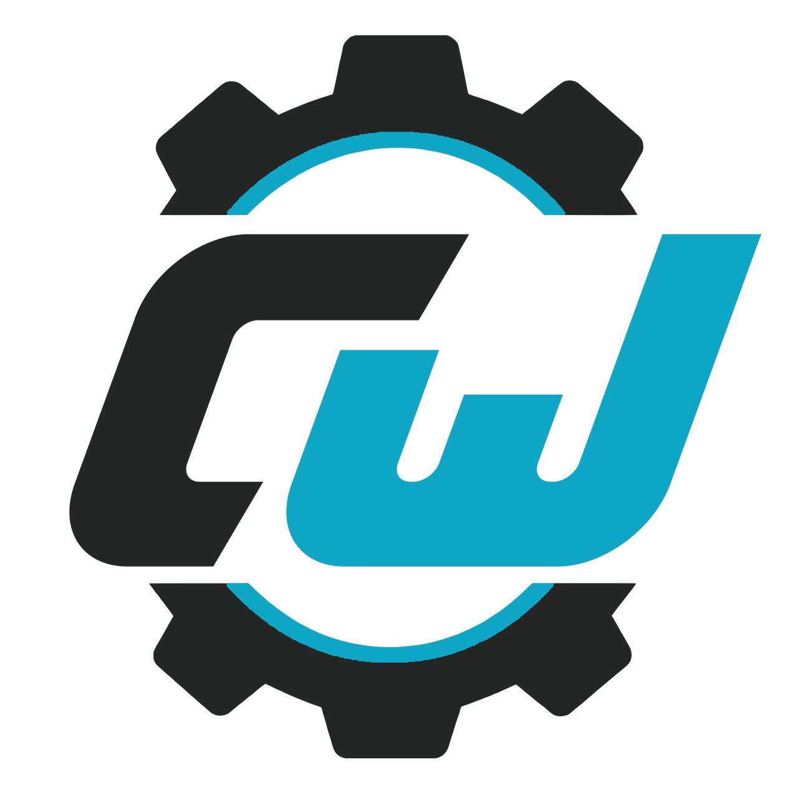

  

# When Technology Doesn't Fit, We Build What Does.

**Chris Sgaraglino, Developer** | More than 30 years of technology and business experience

ILGM helps businesses solve problems through custom software, practical technology consulting, systems integration, and managed hosting. We begin with the business outcome, work backward to the requirements, and build or adapt the technology needed to get there. Our work extends well beyond websites: when existing software cannot support a client's goals, we can develop the missing capability.

This is a public overview of the projects and development work behind ILGM. The source repositories and client systems remain private.

   
  

ILGM develops and maintains a portfolio of **more than 70 WordPress and WooCommerce plugin applications**, combining original software with carefully maintained third-party components. The portfolio supports publishing, commerce, affiliate programs, ROI reporting, link tracking, customer communication, and day-to-day business operations.

Rather than asking businesses to adapt to the limits of off-the-shelf software, ILGM develops practical tools around how clients actually work. Connected commerce and reporting capabilities help businesses improve products and pages, understand results, and make informed decisions without needing to become technical specialists. This portfolio also includes larger initiatives such as NICO and BIS. Client systems and source code remain private.

 

---

 

### NICO Intelligence

   
  

NICO Intelligence (NI) stands for **Natural Intelligence for Client Operations**. NICO is ILGM's developing AI-assisted business operations interface. It is designed to help authorized, nontechnical users work with website content, commerce information, and routine business tasks through natural language, while respecting permissions, approvals, and safeguards.

NICO is developed within the ILGM Plugins portfolio rather than a separate repository. Its goal is to make capable business software easier to use, with Tinker exploring resilient AI options that can support that experience over time.

 

---

 

### Tinker AI Studio

   
  

Tinker is ILGM's working laboratory for adaptable, locally hosted AI. It explores how language models, reusable knowledge, and human-guided workflows can support practical business applications without tying every capability to a single commercial AI provider.

A central goal is **resilience**: developing alternatives when frontier AI services are unavailable, change direction, or become too expensive. Lessons from Tinker inform how ILGM builds dependable AI-assisted tools for clients. Tinker Base and Tinker Wiki support reusable knowledge and documentation. **AI is a tool in the workshop, not the craftsman.**

 

---

 

### SwitchIt

   
  

SwitchIt is a working software project that brings **big railroad operations to small model railroad layouts**. It combines rolling-stock inventory, switching sessions, and realistic operating logic in a Mac-centered application designed for compact layouts and accessible operation.

Beyond model railroading, SwitchIt is a practical development environment for native desktop applications, data modeling, interface design, licensing, and connected-device experiences. Those lessons carry into ILGM's broader client software work.

 

---

 

### CircuitWorks TechBench

   
  

CircuitWorks is ILGM's electronics and embedded-systems workbench, exploring Arduino and ESP32 microcontrollers, sensors, firmware, automation, and data logic. Projects connect physical systems to software and test how information moves between devices and applications.

The focus is on defining the problem first, then choosing the hardware and software that fit. Modular design, repairability, and clear documentation turn experiments into knowledge that can support future business solutions.

 

---

 

### Chris OS

   
  

Chris OS is Chris Sgaraglino's personal knowledge and operating framework. It preserves decisions, observations, standards, and lessons learned across software development, technology, and creative projects.

It supports the same human-led approach used throughout ILGM: understand the goal, record the reasoning, and make useful knowledge available for the next challenge. Widow Creek remains a separate home for Chris's personal interests and exploration.

## The common thread

**Business needs come first.** ILGM brings more than 30 years of experience in consulting and problem solving to software development. WordPress, AI, native Mac applications, and embedded systems are different tools for the same purpose: building useful, maintainable solutions around people and their work.

**Learn more about ILGM at [ilgminc.com](https://ilgminc.com/).**
