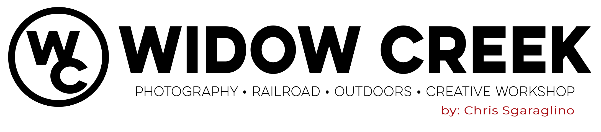
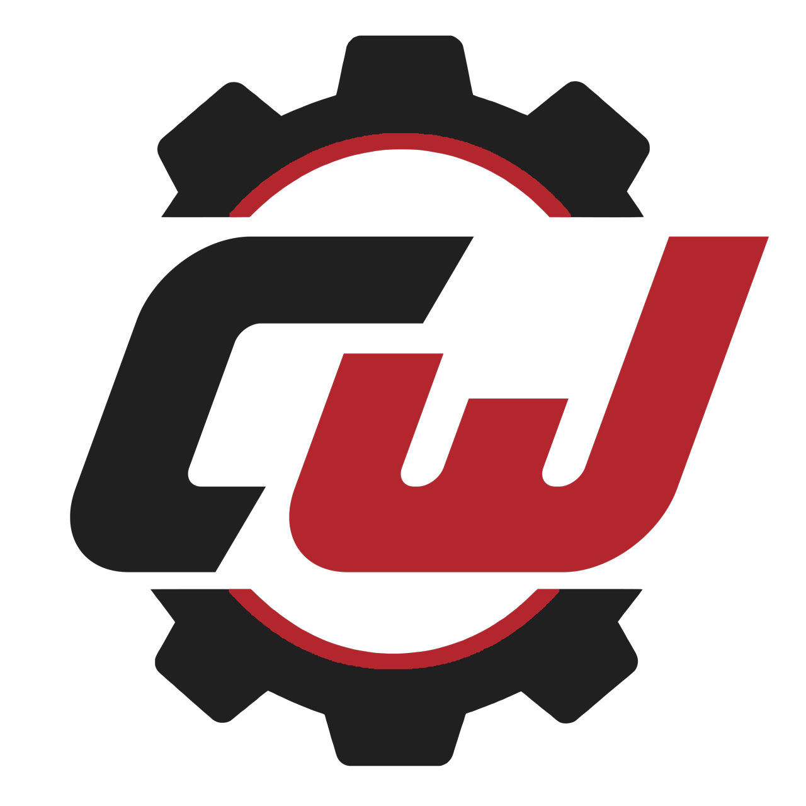
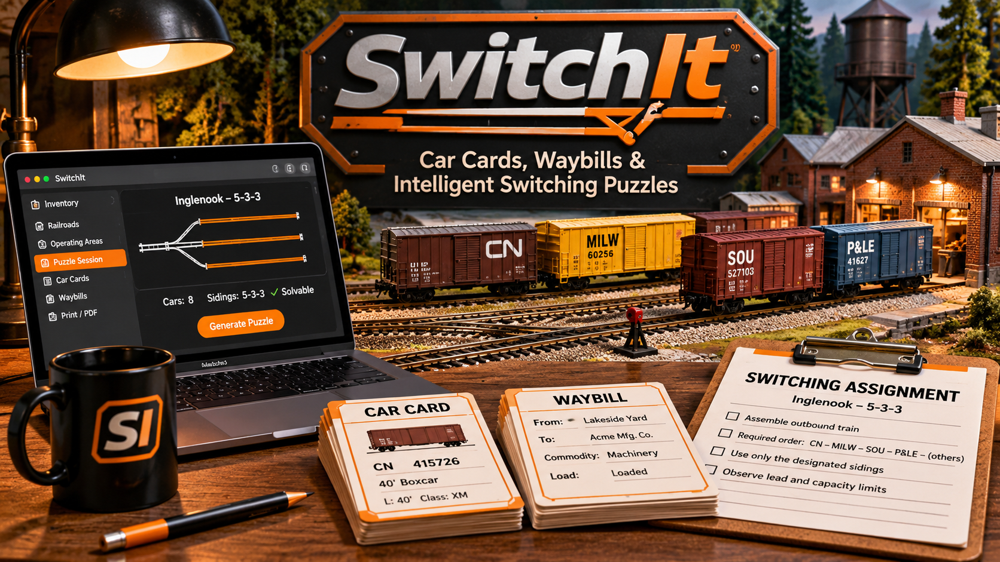

  

### Chris Sgaraglino: Engineering, technology, creativity, and exploration

Widow Creek is the public home for the work of **Chris Sgaraglino**, a developer, engineer, maker, and lifelong experimenter. Software, electronics, model railroading, photography, and the outdoors may look like separate interests, but they share a common approach: follow curiosity, understand the problem, build something useful, and preserve what the experience teaches.

The projects below represent different corners of that workshop. Their development repositories are private, but the ideas, purpose, and engineering philosophy behind them are worth sharing.

 

---

 
 
### Tinker AI Studio

   
  

Tinker is a locally hosted artificial intelligence workshop for building, learning, experimenting, and solving practical problems. It brings together an adaptable application for working with local language models, operating guidance for human and AI collaboration, and reusable configuration and documentation.

The broader effort includes Tinker Base, a curated reference library, and Tinker Wiki, a personal field notebook. The philosophy is simple: **AI is a tool in the workshop, not the craftsman.** Curiosity, experience, and judgment remain human responsibilities.

 

---

 

### CircuitWorks TechBench

   
  

CircuitWorks is the electronics and embedded systems workbench. Its projects span circuits, Arduino and ESP32 microcontrollers, firmware, sensors, automation, and practical electronic systems, including technology for model railroad operations.

Work begins with understanding what a system needs to do, rather than selecting hardware because it happens to be available. Modular designs, repairability, experimentation, and clear documentation help each project contribute to the next. **Understand the problem, build what works, document what matters, and keep learning.**

 

---

 

### ILGM Plugins

   
  

ILGM develops and maintains specialized WordPress and WooCommerce software for real website operations. The work includes original plugins, carefully maintained third party components, automation, integrations, and tools that support publishing, commerce, customer communication, and reporting.

The emphasis is on solving underlying operational problems, respecting existing workflows, and keeping software reliable and maintainable. Consistent interfaces, accessibility, and documentation are part of the engineering, not extras added at the end. Client systems and proprietary source code remain private.

 

---

 

### Chris OS

   
  

Chris OS is the personal knowledge system and shared operating philosophy behind the work. It preserves the reasoning, observations, decisions, and lessons that make experience useful long after a particular project is finished.

Chris OS and Widow Creek are closely connected. Widow Creek is where curiosity becomes projects, stories, experiments, and exploration; Chris OS helps organize and preserve the understanding behind them. It is a human first framework that can work alongside AI without depending on it.

 

---

 

### SwitchIt

   
  

SwitchIt brings **big railroad operations to small model railroad layouts**. It transforms traditional Inglenook switching puzzles and car forwarding into a simple digital experience, with switch lists, car cards, configurable tracks and industries, and realistic capacity based on actual car and siding lengths.

Its virtual interchange yard lets a compact layout draw from a much larger collection of rolling stock, making a few feet of track feel connected to a broader railroad. SwitchIt is being designed for a Mac desktop experience with convenient local network access from phones and tablets. It will operate independently while sharing compatible operating concepts with IRROD and allowing future optional RAILS hardware integration. The project is in planning and architecture review.

## The common thread

These projects serve different purposes, but the principles stay consistent: understand systems before choosing tools, favor useful simplicity, keep people in control, and document what matters. Technology changes. Good engineering habits travel from one project to the next.

**Explore more at [Widow Creek](https://www.widowcreek.com/).**

